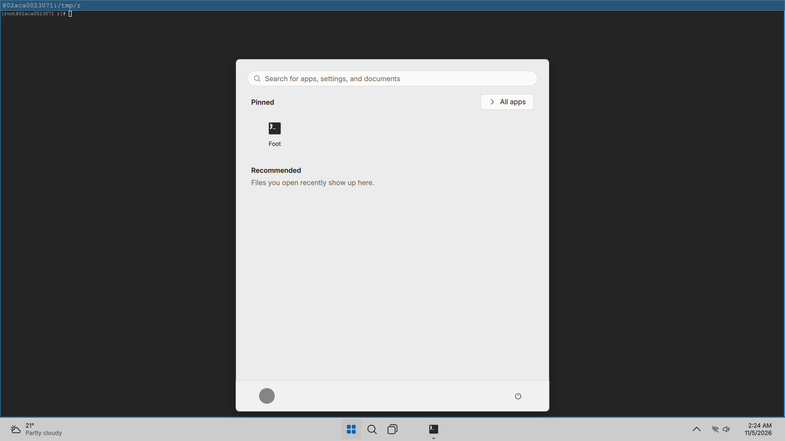
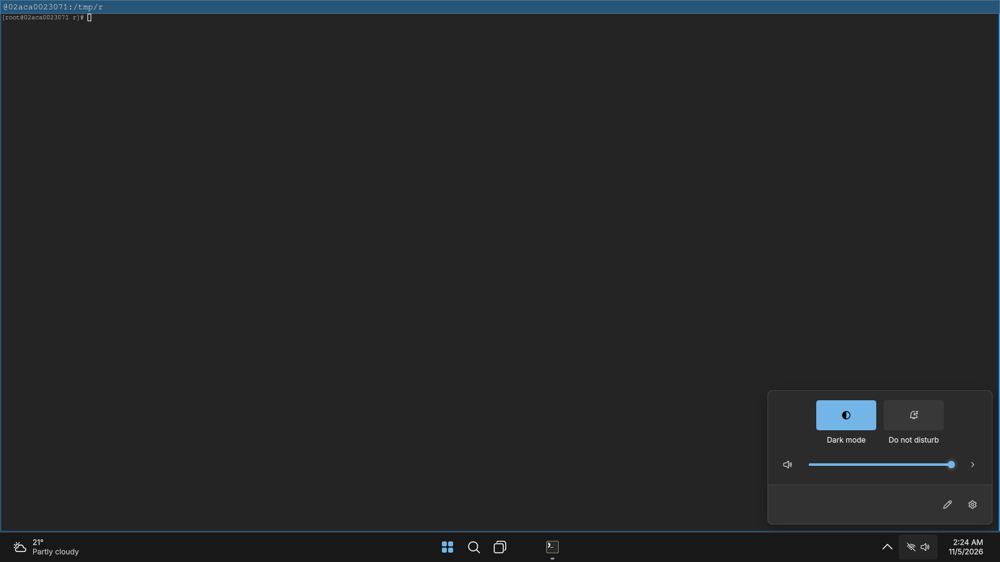
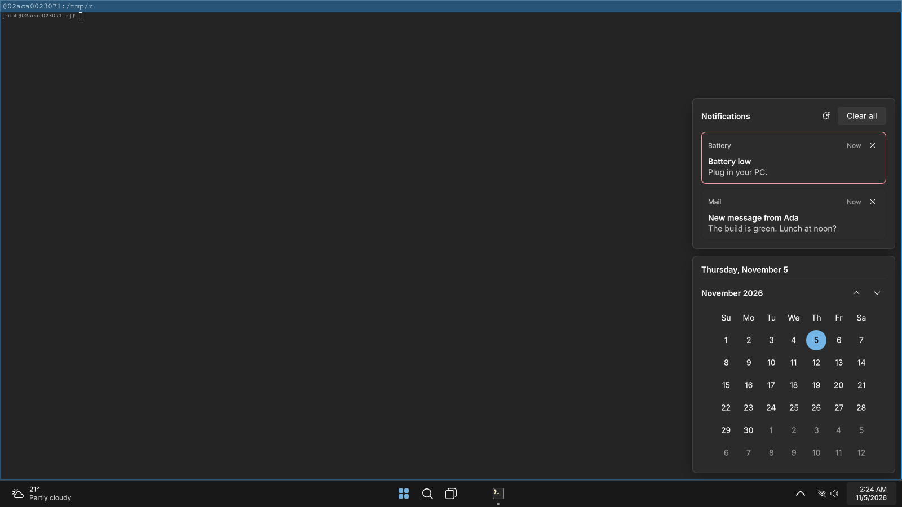
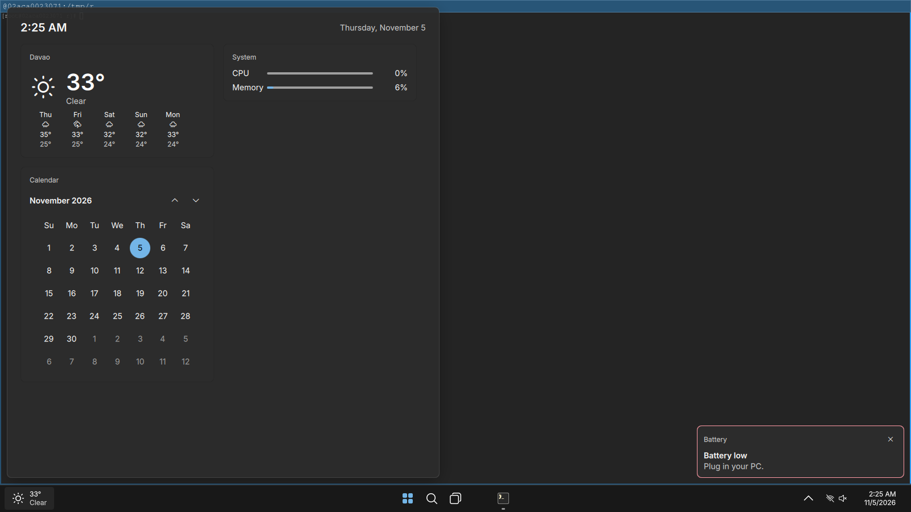
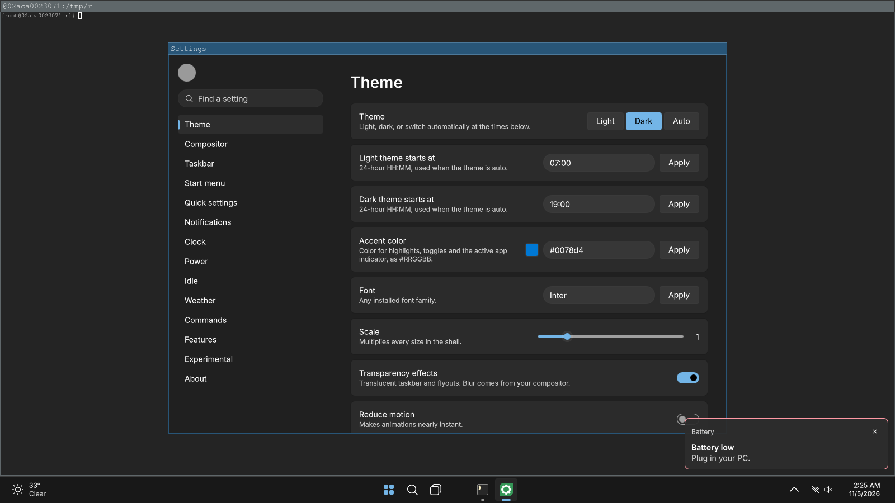
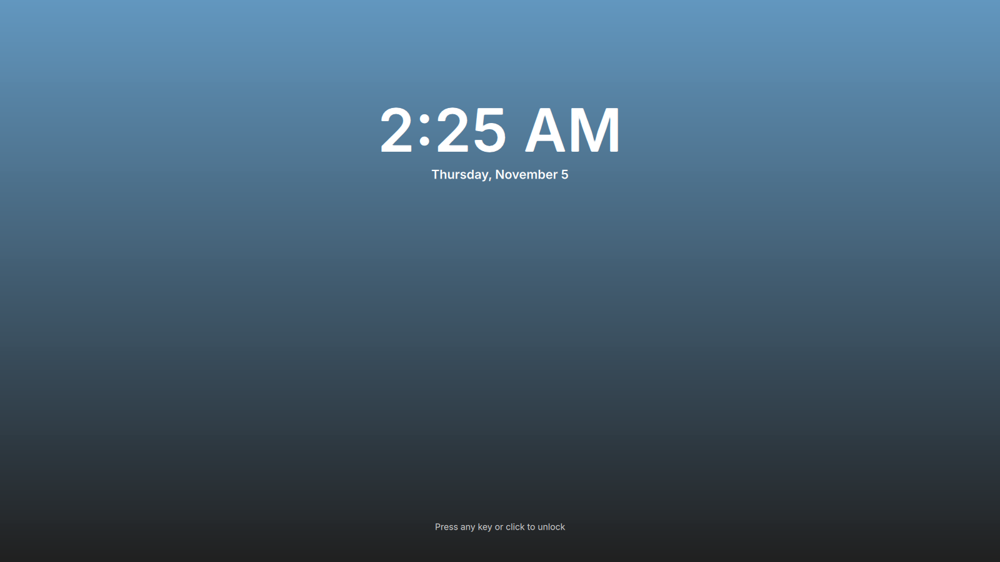

# qs-win-11

A Windows 11 style desktop shell for Wayland, built with
[Quickshell](https://quickshell.org). Hyprland is the first-class target; any
compositor that speaks `wlr-foreign-toplevel-management` works with a reduced
feature set, and more compositors can be added as adapters.

It draws the shell: taskbar, Start, search, Quick Settings, notifications,
calendar, on-screen displays, task view, widgets, lock screen and a Settings
app. Windows and apps stay owned by your compositor and your normal Linux apps.

| | |
|---|---|
|  |  |
|  |  |
|  |  |

Screenshots come from CI under headless sway, so there is no blur; on Hyprland
add the layer rules from [docs/hyprland.md](docs/hyprland.md).

## Features

| Area | What you get |
|---|---|
| Taskbar | Centered or left, auto-hide, pinned and running apps with indicators, tray, clock, system cluster, widgets weather |
| Start and search | Pinned grid, Recommended, All apps, ranked search with best match, Quick Link menu, power menu |
| Quick Settings | Wi-Fi, Bluetooth, airplane, energy saver, night light, dark mode, do not disturb, brightness, volume and output picker, media |
| Notifications | Toasts, grouped history, do not disturb, calendar |
| Windows | Task View, Alt+Tab, show desktop, snap layouts (Hyprland), experimental hover previews |
| System | Volume/brightness/mic OSD, session menu, optional lock screen, idle stages, battery alerts |
| Widgets | Weather and forecast, CPU and memory, media, calendar |
| Settings app | Every setting, generated from the schema, with search and an About page showing why a feature is off |

Light, dark, or auto by time; accent color, scale, transparency and reduced
motion are all settings.

## Requirements

- Quickshell 0.3 or newer (Qt 6)
- A Wayland compositor (Hyprland recommended)
- Optional, each feature degrades without it: PipeWire, NetworkManager, BlueZ,
  UPower, power-profiles-daemon, `brightnessctl`, `hyprsunset`, `libnotify`
  (`notify-send`), GeoClue

## Install

```bash
git clone https://github.com/0x42697262/qs-win-11 ~/.config/quickshell/qs-win-11
```

```bash
qs -c qs-win-11
```

The shell never binds keys. Copy what you want from
[`docs/keybinds.md`](docs/keybinds.md) and `examples/` into your compositor
config. Hyprland users: follow [docs/hyprland.md](docs/hyprland.md) for blur,
keybind formats (Lua, hyprchords, legacy) and known clashes.

## Configure

Settings live in `$XDG_CONFIG_HOME/qs-win-11/settings.json` and only hold what
you changed. Every key, type and default is listed in
[`docs/configuration.md`](docs/configuration.md). The file is watched, so edits
apply live. Invalid values fall back to their defaults and show a notice.

## Develop

```bash
npm ci
```

```bash
npm run verify
```

`verify` runs the type check, the banned-pattern check, the domain tests and
the generated-docs check. CI additionally loads the shell in a headless
compositor, lints every QML file with zero warnings allowed and uploads
screenshots. Read [`AGENTS.md`](AGENTS.md) before changing code.

## License

GPL-3.0. Icons: Fluent UI System Icons (MIT). Font: Inter (OFL).
